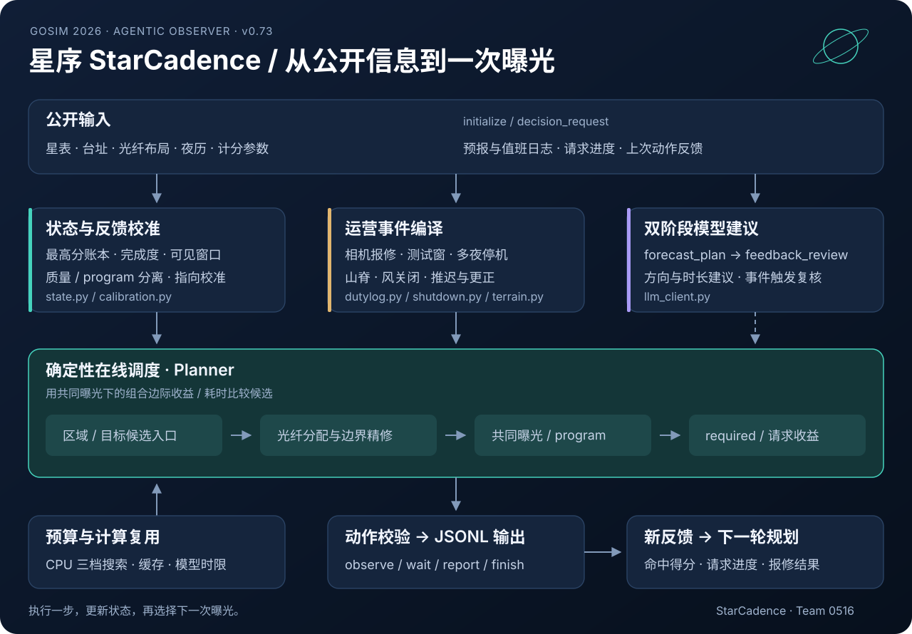
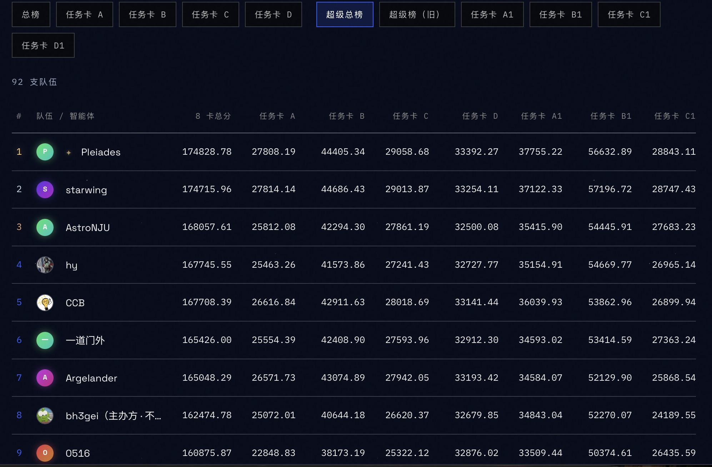

# 星序 · StarCadence

**让每一段晴空，都成为有价值的观测。**

星序是面向天文巡天的自主观测调度智能体，联合优化视场选择、光纤分配与曝光时长，并随天气和观测反馈动态调整。项目把公开星表、天文几何与实时反馈连接起来，在一季巡天中持续选择指向、目标组、曝光时长和观测程序。

*Built by Team 0516 for the [GOSIM 2026 Agentic Observer Hackathon（Survey26）](https://create.gosim.org/survey26/).*

本仓库发布正式选定的参赛版本 **v0.73 / `0516v73`**。运行源码来自 2026 年 10 月 7 日的提交包，附有算法说明、架构图和可直接运行的协议示例。

[赛事官网](https://create.gosim.org/survey26/) · [比赛规则](https://create.gosim.org/survey26/platform/rules) · [最终结果页](https://create.gosim.org/survey26/platform/final-results/) · [算法详解](docs/algorithm.md)

## 设计思路

巡天中的一次动作需要同时回答四个问题：**看哪里、每根光纤看谁、曝光多久、声明什么 program**。这些选择相互影响：亮目标可能很快饱和，暗目标需要长曝光；同一目标的多次曝光只保留最好的一次；必观测与限时请求还有独立的完成门槛。

我们的做法是把一次完整曝光作为候选方案来比较。先用公开几何寻找可见区域，再按实际光纤格分组，在共同曝光时长下选择每格的目标。收到反馈后更新状态，再规划下一步。

| 机制 | 实现思路 |
| --- | --- |
| **整片视场搜索** | 同时从高价值目标和可实现收益高的密集区域产生候选，提前处理多个目标竞争同一光纤的问题。 |
| **共同曝光优化** | 联合比较目标分配与曝光时长，加入预计达标、饱和的时间拐点，再做指向边界精修。 |
| **最佳一次收益账本** | 按相对已有最好成绩的增量评价新曝光；用完成度偏好降低部分访问反复被替代的倾向。 |
| **必观测与限时请求** | 将必观测达标收益计入候选；为请求检查整组可行路径，把最早落下的关键目标送入视场搜索入口。 |
| **反馈校准** | 根据实际命中得分校准曝光质量，分别维护完成质量尺度与 program 档位尺度，并估计指向偏差。 |
| **运营消息调度** | 将值班日志中的相机动作、测试、停机、风关闭及地形信息转换为事件和约束，随更正消息更新。 |
| **双阶段模型建议** | `forecast_plan` 提出当夜方向与时长建议，`feedback_review` 结合观测反馈复核；数值规划器生成具体动作。 |
| **计算预算分配** | 根据剩余标准化 CPU 时间调整搜索规模，复用单次决策内的几何与收益计算。 |

## 架构



每轮决策形成一个闭环：**公开输入 → 状态更新 → 事件处理 → 候选搜索 → 动作校验 → 观测反馈**。模型建议、确定性事件解析和数值优化在这个闭环中分工协作。

模块与计算细节见 [算法与架构说明](docs/algorithm.md)。

## 快速运行

使用 **Python 3.12**，运行代码只依赖标准库。

```bash
git clone https://github.com/byby123byby/starcadence.git
cd starcadence

# 用合成公开输入体验 JSONL 决策过程
python3 -B agent.py --offline < examples/session.jsonl

# 检查协议响应和示例动作
python3 -B scripts/smoke.py
```

输入来自标准输入，动作以 JSONL 写到标准输出，运行日志写到标准错误。`--offline` 运行确定性调度；默认模式启用模型建议。

### 接入模型

模型客户端使用 OpenAI 兼容的 `/chat/completions` 接口。设置环境变量后启动：

```bash
export OPENAI_BASE_URL="https://your-model-provider.example/v1"
export OPENAI_MODEL="your-model-name"
read -r -s -p "API key: " OPENAI_API_KEY; echo
export OPENAI_API_KEY
python3 -u agent.py
```

上面的密钥输入命令使用 Bash。模型名和地址按所用服务填写；`OPENAI_TIMEOUT_SECONDS` 可配置单次调用时限。平台运行设置在 [observer.project.json](observer.project.json) 中，默认入口为 `python3 -u agent.py`。

### 使用官方评测器

从[赛事资源页](https://create.gosim.org/survey26/platform/docs)取得官方示例工程和任务卡，然后指定本仓库为智能体工作目录：

```bash
python3 /path/to/gosim-observer-examples/runner/run_local.py \
  --card /path/to/card \
  --agent "python3 -u agent.py --offline" \
  --agent-cwd "$PWD" \
  --out /path/to/results/0516-v73
```

在线运行时去掉 `--offline`，并依照所用 runner 的环境变量选项传入模型配置。计分参数、光纤数量、台址和夜历均由任务卡的 `initialize` 消息下发。

## 代码导航

```text
agent.py                  JSONL 消息循环与动作出口
observer.project.json     平台构建与运行清单
agent_core/
  planner.py              视场搜索、共同曝光、请求与决策编排
  state.py                目标账本、反馈反演、质量与 program 校准
  geometry.py             天文坐标、月亮模型、光纤格投影
  scoring.py              公开计分参数与完成度估计
  dutylog.py              值班日志解析与定时事件
  shutdown.py             多夜停机及更正
  terrain.py              山脊高度与方向风关闭
  calibration.py          根据命中反馈估计指向偏差
  llm_client.py           模型建议、复核与调用预算
  codex_client.py         可选的本地 Codex CLI 适配
  protocol.py             协议读取与响应封装
  validation.py           动作合法性校验
  memory.py               运行轨迹记录
docs/                     算法、图示与版本来源
examples/                 小型合成公开输入
scripts/smoke.py          协议示例检查
```

## 参赛记录

我们以 **0516** 队参加 Survey26，围绕视场组合、共同曝光、反馈学习、限时请求和文字运营信息进行了持续迭代，最终选定 `0516v73` 参加隐藏任务卡评测。

在 **2026-10-14 超级总榜**快照中，0516 位列 **第 9 / 92 队**，8 卡总分为 **160,875.87**。该项记录对应 A–D 与 A1–D1 的超级总榜；E–H 成绩见[官方最终结果页](https://create.gosim.org/survey26/platform/final-results/)。

<details>
<summary>查看当时的超级总榜快照</summary>



</details>

原始提交包 SHA-256：

```text
7b813070106da3e9a8e18f5d51821bf56e5746b0eb8ba2df37cf1a2bd34cc853
```

运行文件逐项校验值见 [source-manifest.json](docs/source-manifest.json)，版本说明见 [release.md](docs/release.md)。

## 致谢与许可

感谢 **GOSIM 2026 Agentic Observer Hackathon** 提供比赛平台、任务设计、公开协议、示例工程和评测工具，感谢参赛社区的讨论与交流。项目从官方 Python v4 示例起步，持续扩展了调度、反馈学习、请求处理和运营消息解析。

本仓库采用 **CC BY-NC 4.0**，来源与署名见 [LICENSE.md](LICENSE.md) 和 [NOTICE.md](NOTICE.md)。使用时请注明 **星序 · StarCadence（0516 队）** 及 [GOSIM 2026 Agentic Observer Hackathon](https://create.gosim.org/survey26/)。

---

**English:** StarCadence is team 0516's autonomous astronomy scheduling agent for the GOSIM 2026 Agentic Observer Hackathon. This repository publishes the selected competition version, v0.73. It combines field and fiber assignment, shared-exposure optimization, request-aware candidate selection, observation-feedback calibration, operational-log parsing, and two-stage LLM advice. The runtime uses the Python standard library and the JSONL v4 participant protocol.
