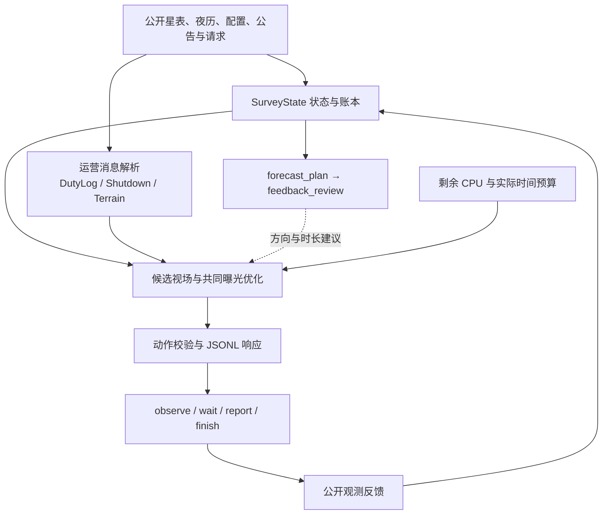

# 从公开信息到一次曝光

v0.73 的核心是在线重规划：每收到一次决策请求，先更新账本与环境估计，再生成并比较当前可执行的曝光。星表、夜历、光纤布局和计分参数来自 `initialize`；公告、请求进度与上一动作结果来自后续消息。

## 1. 状态与空间索引

`SurveyState` 把目标的坐标、通量、科学权重、必观测标记、最高分和估计完成度保存在平行数组中，并建立邻域查询索引。公开台址与夜历用于计算目标的高度角窗口、首次和最后可见夜。

每次曝光之后，状态层按目标更新最高分。收到数据失效与重同步消息时，移除受影响的观测记录，重建剩余有效账本。限时请求的进度取自 `active_requests`，与全季目标最高分分别维护。

对应代码：[state.py](../agent_core/state.py)、[geometry.py](../agent_core/geometry.py)。

## 2. 从目标入口扩展到视场入口

`Planner.plan()` 先找出当前可见目标，结合剩余价值、亮度、可见窗口和历史反馈产生单目标锚点。同时，正常计算档还扫描可见区域，按实际光纤方格估计区域收益，为密集目标组合保留入口。

区域内多个目标若落在同一个光纤格，只能贡献该格的最佳选择。这样，区域排序反映一次曝光真正能够实现的组合收益。锚点生成后，调度器把目标放到不同光纤位置以产生指向，再用局部移动和光纤边界搜索细化候选。

相同分配结构的候选可以复用收益计算；局部投影、月亮位置和目标高度计算也在本轮内缓存。

## 3. 联合选择光纤目标、时长与 program

对于一个指向，调度器枚举共同曝光时间和 `DARK / BRIGHT / BACKUP`，为每根光纤选择预计边际收益最高的目标。

预计完成因子为：

```text
f(i, T) = min(flux_i × T × Q_hat(i, T) / (f0 × T0), 1)
```

其中 `Q_hat` 由公开高度角、月光模型与反馈校准尺度构成，并应用参赛版的 `PLAN_FACTOR_SAFETY = 0.9` 规划余量。几何质量在曝光中点估价，时长同时受夜末、目标可见窗口、最大曝光时长及已知事件边界限制。

科学增量为：

```text
Δscience_i = max(weight_i × f(i, T) × program_multiplier − best_score_i, 0)
```

候选价值在此基础上加入三类因素：

- 完成度系数 `0.8 + 0.2 × f`，偏好一次取得更完整的访问结果。
- 当曝光跨过 required 门槛时，加入对应的达标价值，并结合可见夜窗口和已有尝试调整优先级。
- 对预计可完成的限时请求，将整组奖励按各目标预计曝光成本分配到候选中。

共同曝光候选既包含离散时长，也包含目标饱和、required 达标和请求达标的时间拐点。最终按组合增益与耗时之比选择当前动作，执行后用新反馈重规划。

对应代码：`Planner._marginal_gain()`、`Planner.plan()`，见 [planner.py](../agent_core/planner.py)；公开计分参数见 [scoring.py](../agent_core/scoring.py)。

## 4. 让限时请求真正进入视场搜索

请求奖励取决于一组目标是否在截止前完成。`_request_bundles()` 先计算还差多少目标，再检查各目标的曝光成本、可见窗口和请求截止时间，使用 20% 的时间余量估算组合可行性。

若当夜无法完成整组，`_request_schedule()` 继续检查公开夜历中的后续窗口，形成暂定路径。当前只暴露下一步，之后随反馈重新计算。

v0.73 的具体改进是 **request heads**：对当夜可行且带奖励的请求，把组合中最早落下的目标加入搜索锚点，并按实际请求截止时间排序。这样，请求价值既影响收益计算，也能影响“去哪里搜索”。

## 5. 分开学习完成质量和 program 档位

曝光得分同时受完成度和 program 倍率影响。状态层用整次曝光的一组命中共同解释这些因素：未饱和命中提供数值约束，饱和命中提供下界，可辨识的匹配或失配提供 program 条件。

实现分别维护：

- `scale`：用于估计曝光完成质量和所需时长。
- `program_scale`：用于判定 program 档位。

这让程序选择与曝光效率可以分别响应反馈。另一个独立的 `PointingCalibration` 根据命中和未命中的几何一致性估计固定指向偏差，修正实际输出的高度角与方位角。

对应代码：`_joint_quality_intervals()`、`calibrate_program()`、`update_scale()`、`program_band()`，见 [state.py](../agent_core/state.py)；指向校准见 [calibration.py](../agent_core/calibration.py)。

## 6. 把运营日志变成调度事件

规则解析器将已收到的值班日志转换为统一时间和约束：

| 信息 | 进入决策的方式 |
| --- | --- |
| 相机动作、推迟与更正 | 维护定时报修事件，在事件后的决策点处理。 |
| 已解析的平场灯测试 | 维护测试窗口，窗口内等待，曝光在边界前结束。 |
| 多夜整台停机 | 按公开夜标签匹配停机日期，逐 slot 等待并接收更正。 |
| 山脊高度 | 更新相应方向的最低可观测高度。 |
| 当夜方向风关闭或取消 | 更新相应扇区的可用状态。 |

时间解析覆盖本地时间、UTC、东京时间、中文时间、唱名数字以及部分相对时刻表达。已公告事件报修与观测反馈诊断共同服务于仪器管理；举报反馈更新各自的状态与额度。

对应代码：[dutylog.py](../agent_core/dutylog.py)、[shutdown.py](../agent_core/shutdown.py)、[terrain.py](../agent_core/terrain.py)，以及 `Planner.decide()`、`_scheduled_report()`、`_maybe_report()`。

## 7. 模型建议与数值规划的分工

`forecast_plan` 读取当夜预报和当前公告，提出避开方向与时长系数；`feedback_review` 再结合命中反馈复核这份提案。建议以固定结构返回：

```json
{"avoid_directions": ["SE"], "duration_scale": 1.0}
```

方向建议与公开公告中的方向集合对齐，时长系数用于调整搜索网格。数值规划器继续负责目标、光纤、指向和实际曝光。故障证据满足规则条件时，还可调用 `fault_review` 复核报修。

公告、质量或首次反馈发生变化时重新取得建议；相同条件下复用建议，最长七天后刷新。模型的实际时间预算与调度器的标准化 CPU 预算分别管理。

## 8. 计算预算与执行闭环

`_pace()` 使用剩余标准化 CPU 时间和估计剩余决策数切换三档搜索。正常档保留区域搜索和较完整的精修，紧张时减少入口与计算规模。几何与候选收益缓存仅在当前决策中复用，因此下一次反馈会重新参与估价。



这一架构把运行中的学习落实在质量、program、指向和目标账本上，再把新的估计用于下一次调度。
